#+SETUPFILE: https://fniessen.github.io/org-html-themes/org/setup/html-theme-readtheorg.setup
#+Title: Submitting your final assignment
#+Author: Jan Boone
#+LANGUAGE: en
#+INFOJS_OPT: view:showall toc:t ltoc:t mouse:underline path:http://orgmode.org/org-info.js
#+LaTeX_CLASS: article-12
#+LATEX_HEADER: \renewcommand{\floatpagefraction}{.8} %% avoids figures getting their own page
#+latex_header: \input{author.tex}
#+latex_engraved_theme: t
#+EXPORT_SELECT_TAGS: export
#+EXPORT_EXCLUDE_TAGS: noexport
#+OPTIONS: toc:nil num:2 timestamp:nil ':t \n:nil @:t ::t |:t ^:{} _:{} *:t TeX:t LaTeX:t
#+HTML_HEAD: <link rel="stylesheet" href="./css/Latex.css">
#+HTML_HEAD: <link rel="stylesheet" href="https://latex.now.sh/prism/prism.css">
#+HTML_HEAD: 
#+HTML_HEAD: 
#+EXPORT_EXCLUDE_TAGS: noexport

* Introduction

For this course we use Github to submit your assignment. We are aware that most of you have not used Github before. Github may feel unfamiliar, but you only need to follow these steps once. It is simpler than it looks.

This file helps you to submit your final assignment. Below we explain the following steps:
- sign up to get a github account
- create a github repository for your final assignment
- choose the setting of the repository (e.g. make it a private repository)
- share the repository with me (and a fellow student if you do the assignment together)
- upload your assignment to the repository
- fill in the google form

Following these six steps will take approx. fifteen minutes.

* Sign up at github

- Go to [[https://github.com/]] and sign up to create an account.
- Github will send you a verification email. Click the link before proceeding.
- After creating an account and signing in, go to [[https://github.com/repos]] which lists all your repositories (if you just signed up, there will be no repositories)

* Create new repository

- Click on the button "New repository":

#+DOWNLOADED: screenshot @ 2026-11-07 17:03:59
#+attr_org: :width 800px
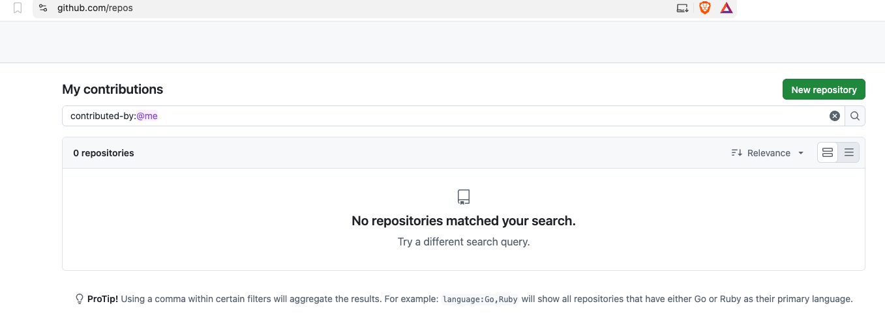

* Repository python-assignment

- fill in the form:

#+DOWNLOADED: screenshot @ 2026-11-07 17:06:15
#+attr_org: :width 800px
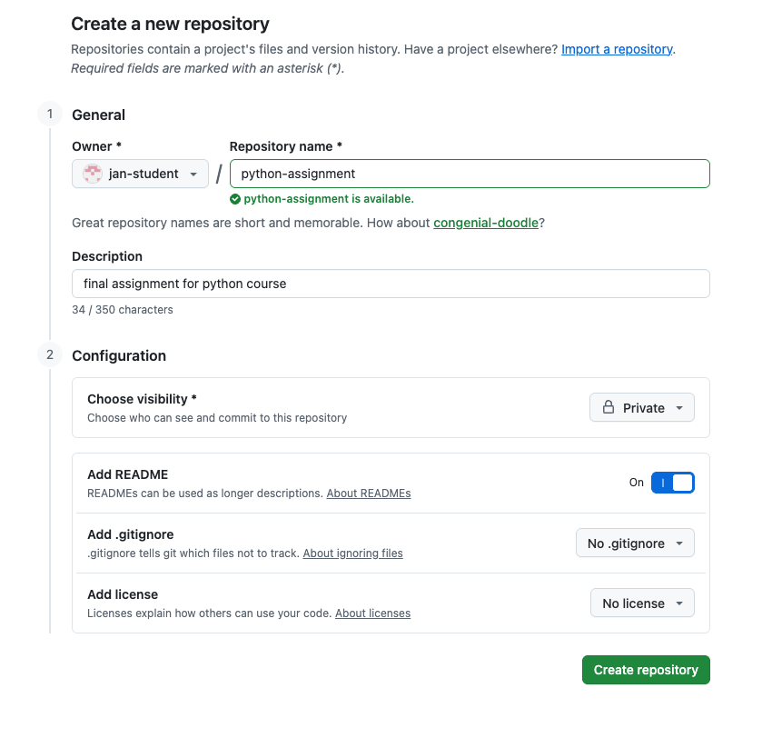

- Fill in:
  - the Repository name: =python-assignment=
  - give a brief description of the repository
  - Configuration:
    - visibility: choose =private= (we will upload your grade file on this repository and you probably do not want everyone to see this)
    - Add README: =on=
  - do not worry about =.gitignore= nor =license=
- click Create repository button

* Sharing repository

- Go to Settings which can be found just above the name of the repository =python-assignment=

#+DOWNLOADED: screenshot @ 2026-11-07 17:10:43
#+attr_org: :width 800px
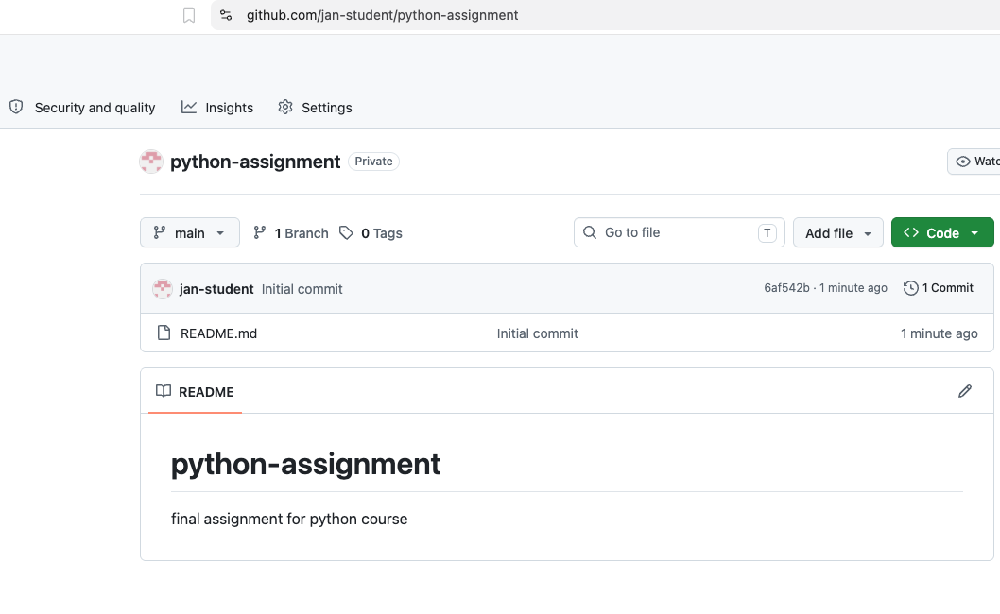

- You will see this menu:

#+DOWNLOADED: screenshot @ 2026-11-07 17:12:23
#+attr_org: :width 800px
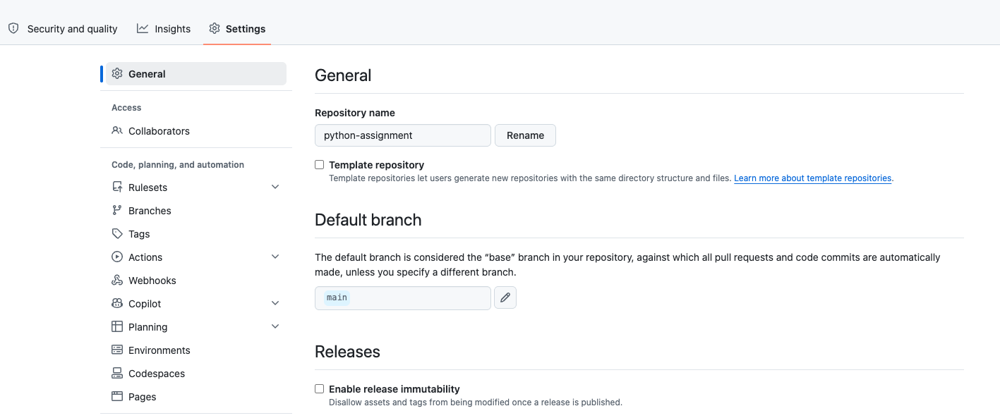

- Click on Collaborators in the left column (under General).
- Under Manage Access, click on Add people

#+DOWNLOADED: screenshot @ 2026-11-07 17:14:01
#+attr_org: :width 800px
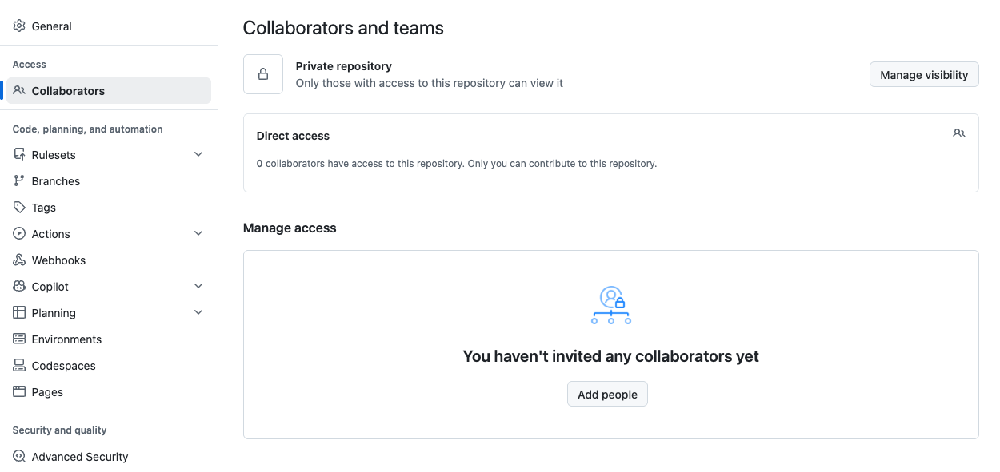

- You will see the following where you type "jan boone"
#+DOWNLOADED: screenshot @ 2026-11-07 17:14:54
#+attr_org: :width 800px
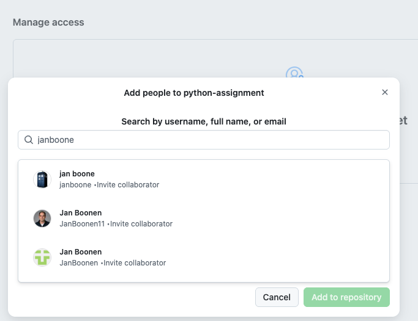

- Click on *jan boone* (that is, me) and Add to repository.

#+DOWNLOADED: screenshot @ 2026-11-07 17:15:49
#+attr_org: :width 800px
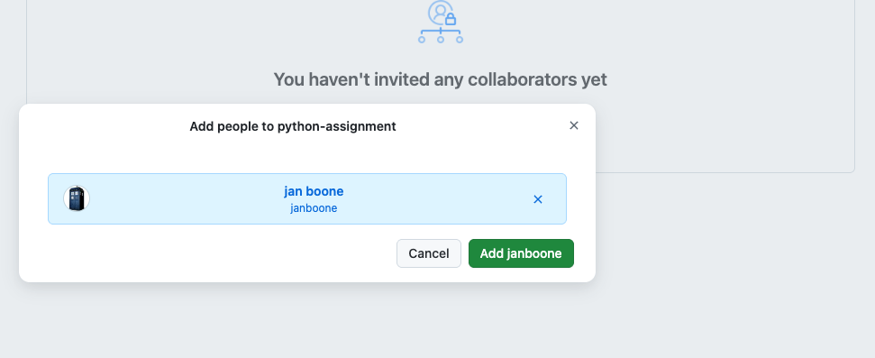

- Click on Add janboone
- This will make sure that I can see your repository and grade your assignment. If you do the assignment with another student, add their name as well.
- Github sends me an invite which I will accept.

#+DOWNLOADED: screenshot @ 2026-11-07 17:18:00
#+attr_org: :width 800px
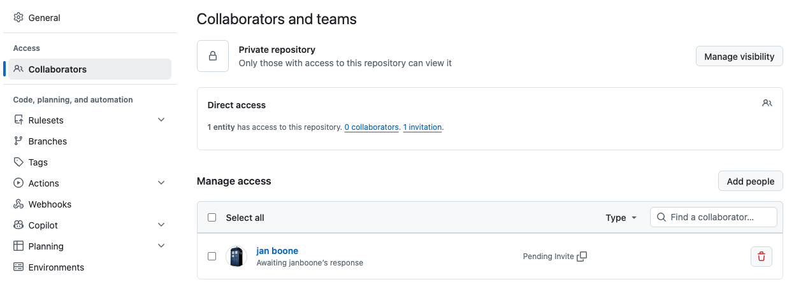

* Upload your assignment

- Once you finish your assignment, you can upload it on github

** download assignment from the university server

- If you work on the university server and have a notebook open, click on the icon on the top left (=FILES=)
- On the marimo file with the assignment (=assignment_gender_economics.py=) in the example below
- Click on the three dots on the right of the file to get the dropdown menu:

#+DOWNLOADED: screenshot @ 2026-11-09 13:47:38
#+attr_org: :width 800px
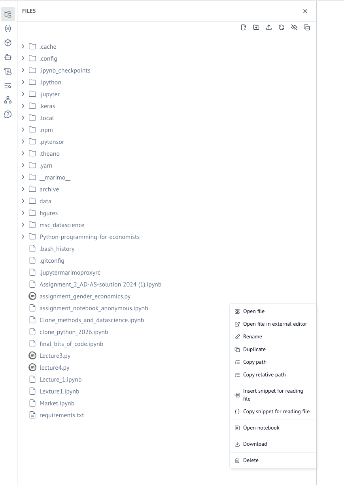

- In the menu click =Download=
- Save the file, e.g. in the Downloads folder

- If you work on your own laptop, find out where your assignment is (or copy your assignment to the Downloads folder). Then upload your assignment from this folder. 

** Github

- Go to the github repository that you created above
- Click on Add file and then Upload files:

#+DOWNLOADED: screenshot @ 2026-11-09 13:50:10
#+attr_org: :width 800px
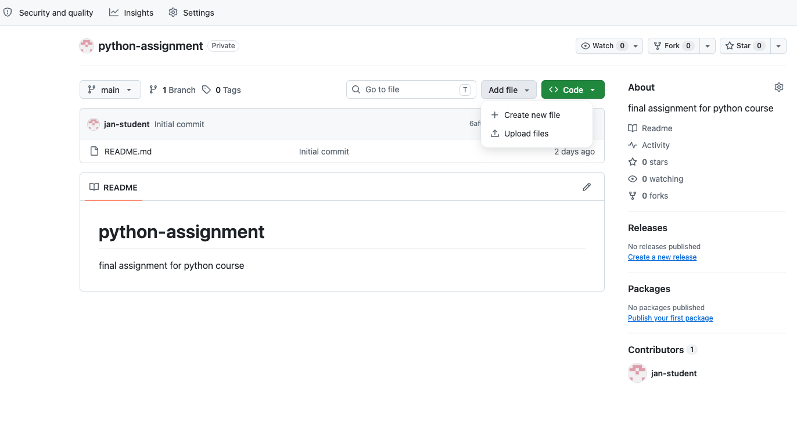

- Drag your file or click =choose your files=
- add your file; in my case =assignment_gender_economics.py=
- add a commit message
- click Commit changes

#+DOWNLOADED: screenshot @ 2026-11-09 13:52:36
#+attr_org: :width 800px
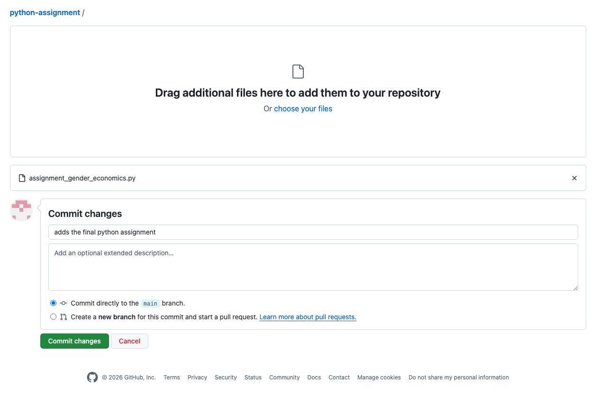

- Your file is added to the repository
- Github records the commitment date and time; make sure you commit your file before the deadline and do not change it after the deadline.

** Important
- When we clone your repository from github, your app should work
- To illustrate, if you load data in your app, these data should be uploaded on github as well
  - otherwise, a statement like =df = pd.read_csv("./data/my_data.csv")= will give an error and your app does not work

* Share the repository address

- When you submit your assignment, you fill in a google form. This will make sure that your repository is coupled to your name and SNR for the exam administration.
- The google form asks you for the address of your repository:

#+DOWNLOADED: screenshot @ 2026-11-07 17:20:39
#+attr_org: :width 800px
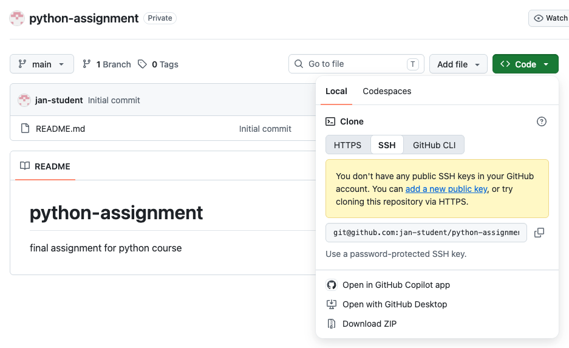

- In your repository click on the green button =< > Code= and then on =SSH=:
  - Copy the repository address (SSH format); in this case =git@github.com:jan-student/python-assignment.git= but that will be different for you
    - your address should begin with =git@github.com:= and then your github name and the name of your repository with =.git= at the end
    - do *not* copy the =https= address *nor* the =GitHub CLI= address
- Go to the Google form (we published the address in a Canvas announcement)
  - you can only log in to the google form with your =@tilburguniversity.edu= address
- Paste your repository's =SSH= address in the google form:

#+DOWNLOADED: screenshot @ 2026-11-09 14:03:58
#+attr_org: :width 800px
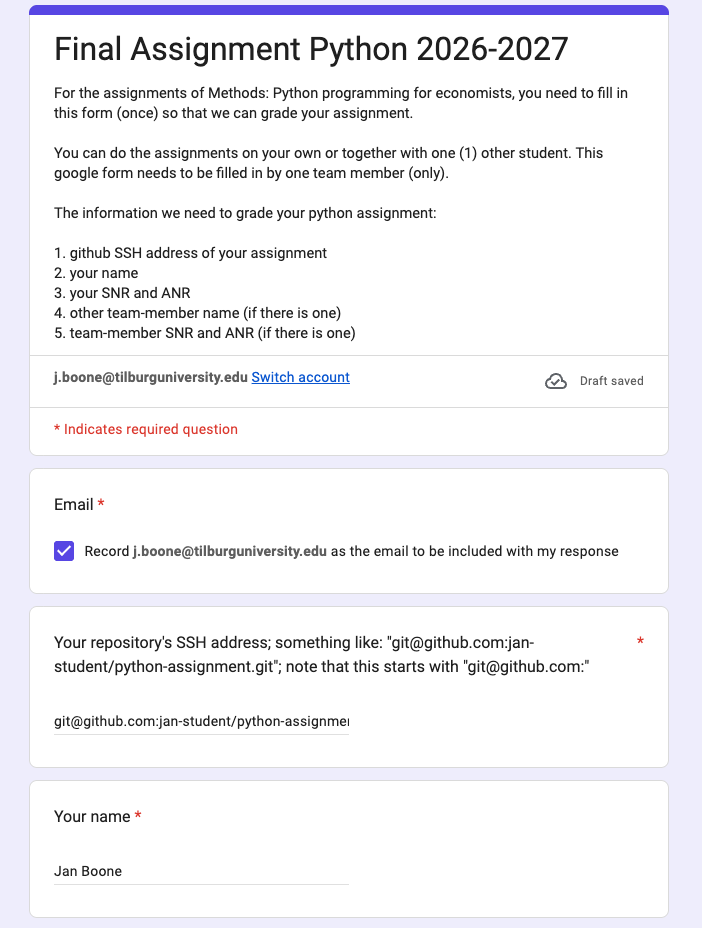

- Submit the google form and you are done!

# Local Variables:
# org-download-image-dir: "./screenshots/"
# End:
